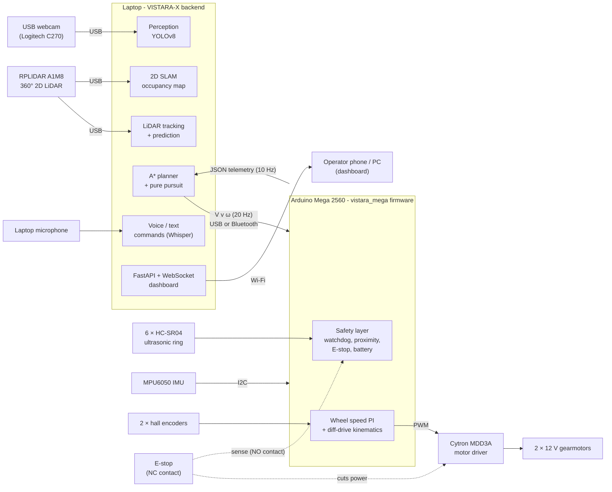
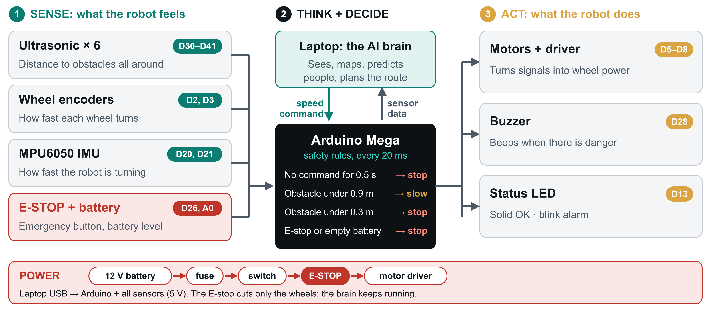
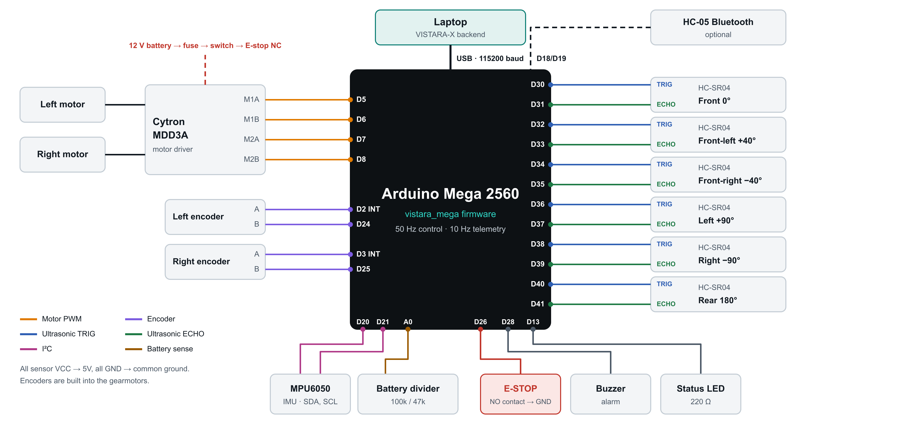
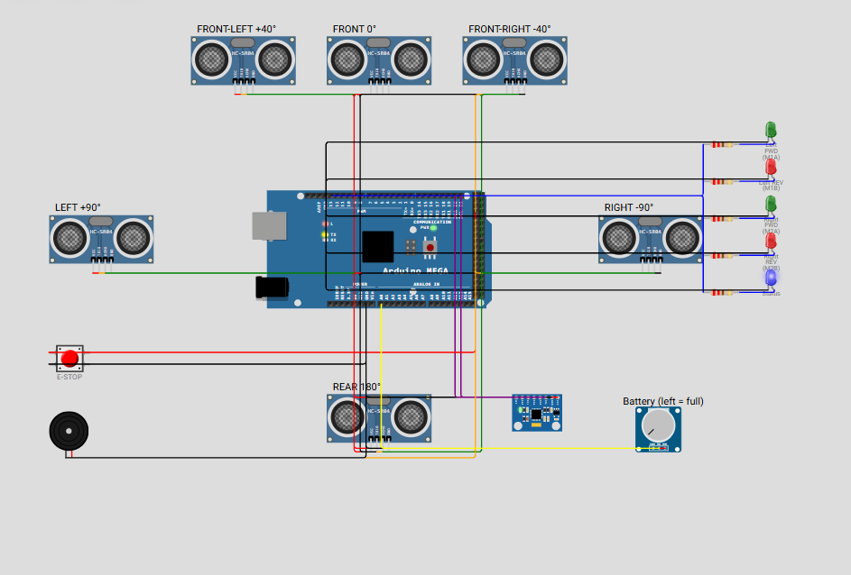
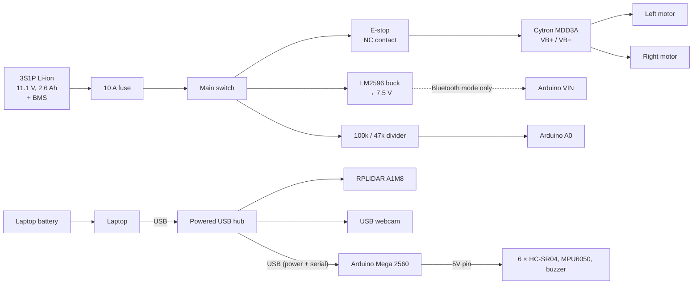
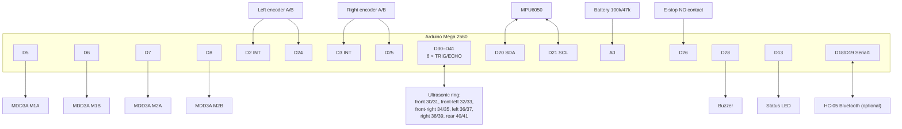

# VISTARA-X hardware

This folder documents the physical robot VISTARA-X is designed for, and contains a working simulation of its electronics.

The design is **Arduino-based**: an Arduino Mega 2560 drives the motors, reads the sensors and enforces the safety rules. The heavy software (YOLOv8, SLAM, motion prediction, A\* planning, Whisper speech recognition, dashboard) cannot run on a microcontroller, so it runs on a **laptop carried by the robot**, the same laptop the backend runs on today. No Raspberry Pi is needed.

The project has no physical build yet. The hardware is simulated at two levels:

| Level | What is simulated | Tool | Where |
|---|---|---|---|
| **Robot and environment** | The full robot: 2D LiDAR, 6 ultrasonic sensors, IMU, wheel odometry, camera, differential-drive motion, collisions, people and carts moving around it | Python + PyBullet (the VISTARA-X backend) | [backend/](../backend/), run guide in the [main README](../README.md#getting-started) |
| **Electronics and firmware** | The Arduino Mega controller with its real pin map: 6 HC-SR04 ultrasonic sensors, MPU6050 IMU, motor driver outputs, E-stop button, buzzer, battery monitor | [Wokwi](https://wokwi.com) (Arduino simulator) | [firmware/vistara_mega/](firmware/vistara_mega/) |

Both levels use the same numbers: the same sensor layout (ultrasonic cones at 0°, ±40°, ±90°, 180°, 2 m range), the same safety distances (slow at 0.9 m, stop at 0.3 m), the same top speed (0.9 m/s) and the same 10 Hz telemetry rate. The serial protocol between them is defined below, so the backend can drive the real board later without changes to the navigation code.

## Contents

1. [System architecture](#1-system-architecture)
2. [Hardware components and specifications](#2-hardware-components-and-specifications)
3. [Circuit diagrams and connections](#3-circuit-diagrams-and-connections)
4. [Power budget](#4-power-budget)
5. [Simulation setup: how to run and test it](#5-simulation-setup-how-to-run-and-test-it)
6. [Firmware and serial protocol](#6-firmware-and-serial-protocol)
7. [Proposed physical implementation](#7-proposed-physical-implementation)
8. [Simulation limitations](#8-simulation-limitations)
9. [Hardware implementation plan](#9-hardware-implementation-plan)

---

## 1. System architecture

The robot has two computers with separate jobs:

- **Laptop (on the robot's top deck):** runs the existing VISTARA-X backend: perception (YOLOv8), LiDAR tracking and motion prediction, SLAM, A\* planning, pure-pursuit control, speech commands, and the dashboard server. It outputs one thing to the motors: a body velocity command *(v, ω)* 20 times a second.
- **Arduino Mega 2560:** turns *(v, ω)* into wheel speeds, closes the wheel speed loop with the encoders, reads the ultrasonic ring and IMU, and enforces the safety rules on its own. If the laptop freezes or the cable is pulled, the Arduino stops the robot within 0.5 s.

A hardware E-stop cuts motor power directly, independent of both.

**Why not an Arduino alone?** An Arduino Mega has 8 KB of RAM. YOLOv8 needs about 1 GB, Whisper about 1 GB, and SLAM, tracking and the dashboard need Python. An Arduino on its own would make a simple "stop when something is in front" robot, without the prediction that is the point of VISTARA-X. The Arduino does what it is good at (real-time control and safety), and the laptop does the thinking.



Each block on the laptop already exists in the backend and runs today against simulated sensors ([backend/app/](../backend/app/)). The interfaces were kept the same as on a real robot: a LiDAR scan, odometry, IMU readings, and a velocity command out.

---

## 2. Hardware components and specifications

Prices are approximate Indian retail prices (Robu.in, Robocraze, Amazon.in) and should be checked before buying.

### 2.1 Computing and sensing

| # | Component | Qty | Key specifications | Role in VISTARA-X | Counterpart in the simulation | Approx. price (₹) |
|---|---|---|---|---|---|---|
| 1 | **Laptop** (the team's existing one) | 1 | 4+ CPU cores, 8 GB RAM, 3 USB ports (or a hub), Wi-Fi, Python 3.10+ | Runs the whole backend: perception, tracking, prediction, SLAM, planning, speech, dashboard | The laptop running `uvicorn app.main:app` | 0 (already owned) |
| 2 | **Arduino Mega 2560** (CH340 compatible board) | 1 | ATmega2560 16 MHz, 8 KB RAM, 54 digital I/O (15 PWM), 16 analog inputs, 6 external interrupts, 4 hardware UARTs | Low-level controller: motors, encoders, ultrasonic ring, IMU, safety | Wokwi Arduino Mega (this folder) | 900 |
| 3 | **SLAMTEC RPLIDAR A1M8** | 1 | 360°, 0.15–12 m, 8000 samples/s, 5.5–10 Hz, USB adapter included | SLAM, LiDAR object tracking and motion prediction, corridor clearance | Simulated 2D LiDAR: 360°, 2° resolution, 8 m, 10 Hz, σ = 1 cm | 8,500 |
| 4 | **USB webcam** (Logitech C270 or similar) | 1 | 720p, 30 fps, 60° field of view | Object detection with YOLOv8 on the laptop; the distance to each object comes from the LiDAR | PyBullet RGB camera, 4 Hz | 1,600 |
| 5 | **HC-SR04 ultrasonic sensor** | 6 | 2–400 cm, 15° cone, 40 kHz, 5 V | Close-range ring at 0°, ±40°, ±90°, 180°: sees glass and low objects the LiDAR misses | Simulated 6-cone ring, 2 m range | 6 × 70 |
| 6 | **MPU6050 IMU** (GY-521 board) | 1 | 3-axis gyro ±250 °/s, 3-axis accelerometer ±2 g, I²C 0x68 | Yaw rate for odometry correction, tilt and bump detection | Simulated IMU with gyro bias, 20 Hz | 150 |
| 7 | **HC-05 Bluetooth module** (optional) | 1 | Bluetooth 2.0 SPP, UART | Wireless link to the laptop instead of the USB cable (Serial1) | — | 350 |
| 8 | **Powered USB hub**, 4 ports | 1 | USB 3.0 | LiDAR, webcam and Arduino on a laptop with few ports | — | 500 |

### 2.2 Drive and chassis

| # | Component | Qty | Key specifications | Role | Counterpart in the simulation | Approx. price (₹) |
|---|---|---|---|---|---|---|
| 9 | **JGB37-520 12 V gearmotor with hall encoder** | 2 | 178 rpm at 12 V (≈ 56:1 gearbox), 11 PPR encoder → ≈ 616 pulses per wheel turn, stall ≈ 2 A | Differential drive. 178 rpm with a 100 mm wheel gives 0.93 m/s, just above the 0.9 m/s speed limit in the software | Differential-drive model with wheel slip; wheel odometry at 20 Hz | 2 × 1,000 |
| 10 | **Cytron MDD3A dual motor driver** | 1 | 4–16 V, 3 A continuous / 5 A peak per channel, 1.8–12 V logic | Drives both motors from Arduino PWM. (Budget option: L298N with ENA/ENB jumpers, same 4-pin interface, but it drops ≈ 2 V and runs hot) | LED brightness in Wokwi | 900 |
| 11 | **100 mm rubber wheel** with 6 mm hub coupling | 2 | 100 mm diameter | Drive wheels | `WHEEL_DIAMETER = 0.100` | 2 × 250 |
| 12 | **Ball caster**, 1 inch | 2 | Metal ball | Front and rear support | — | 2 × 100 |
| 13 | **Chassis**: 2-deck round base, 600 mm diameter, 5 mm acrylic or 3 mm aluminium, M3 standoffs | 1 | Round footprint, 0.30 m radius; top deck holds a 15.6" laptop | Holds everything; round so the robot can turn in place without its corners hitting anything | `ROBOT_RADIUS = 0.30` m | 1,500 |
| 14 | **Front bumper switch** (2 × micro limit switches behind a flexible strip) | 1 set | — | Last-resort contact detection (optional, wired in parallel with the E-stop sense line) | PyBullet contact veto | 150 |

### 2.3 Power and safety

| # | Component | Qty | Key specifications | Role | Approx. price (₹) |
|---|---|---|---|---|---|
| 15 | **3S1P Li-ion pack**: 3 × 18650 cells (2,600 mAh) + 3S 20 A BMS + holder | 1 | 11.1 V nominal (9.0–12.6 V), 2.6 Ah, ≈ 29 Wh | Motors and the Arduino when it runs on Bluetooth. The laptop, LiDAR and webcam run on the laptop's own battery | 3 × 250 + 300 + 150 |
| 16 | **3S Li-ion charger**, 12.6 V 2 A | 1 | CC/CV | Charging at the dock | 600 |
| 17 | **Emergency stop**, 22 mm mushroom-head, twist release, 1 NC + 1 NO contact block | 1 | 10 A contact rating | NC contact cuts motor power; NO contact tells the Arduino | 300 |
| 18 | **LM2596 buck converter** set to 7.5 V | 1 | 3 A | Powers the Arduino from the battery (VIN) when it runs on Bluetooth without the USB cable | 150 |
| 19 | **Main switch** (rocker, 10 A) + **blade fuse holder with 10 A fuse** | 1 + 1 | — | Master on/off, short-circuit protection | 150 |
| 20 | **Voltage divider** 100 kΩ / 47 kΩ (1 %) | 1 | 12.6 V → 4.03 V | Battery voltage to Arduino A0 | 10 |
| 21 | **Active buzzer** + status LED + 220 Ω resistor | 1 | 5 V | Audible alarm for E-stop, obstacle stop, low battery | 50 |
| 22 | Wiring: XT60 connectors, 18 AWG power wire, Dupont leads, USB cables, heat-shrink, perfboard | — | — | — | 800 |

**Estimated total: ≈ ₹21,000**, using a laptop the team already owns.

**Optional upgrade:** a Luxonis OAK-D Lite (RGB + stereo depth, YOLOv8 runs on the camera itself) instead of the webcam, for about ₹14,400 more. It frees the laptop CPU and gives depth for every detection.

### 2.4 Why an Arduino Mega and not an Uno

| Need | Pins | Uno | Mega |
|---|---|---|---|
| 6 ultrasonic sensors (trigger + echo each) | 12 | ✗ too few pins left | ✓ pins 30–41 |
| 2 encoders on external interrupts | 2 interrupt + 2 | only 2 interrupts in total | ✓ 6 interrupt pins |
| 4 motor PWM outputs | 4 PWM | ✓ but shares timers with `tone()` | ✓ on timers 3 and 4 |
| IMU (I²C), E-stop, buzzer, LED, battery | 6 | ✗ | ✓ |
| USB to laptop + Bluetooth at the same time | 2 UARTs | ✗ one UART | ✓ four UARTs |
| RAM for buffers and telemetry | — | 2 KB | 8 KB |

---

## 3. Circuit diagrams and connections

The interactive circuit is in [firmware/vistara_mega/diagram.json](firmware/vistara_mega/diagram.json). Open it in Wokwi (section 5) to see and run it. The diagrams below show the full robot, including the parts Wokwi cannot simulate.



*How the circuit works: what each part does ([SVG](docs/how-it-works.svg)).*



*Wiring of the Arduino Mega 2560 ([SVG](docs/circuit-diagram.svg)).*



*The same circuit running in the Wokwi simulator. The motor driver inputs are shown as LEDs.*

### 3.1 Power distribution



The E-stop sits between the battery and the motor driver only. Pressing it stops the wheels at once, while the laptop and the Arduino keep running, so the robot keeps its map and position and reports the stop on the dashboard.

### 3.2 Arduino Mega pin map

| Arduino pin | Connected to | Direction | Notes |
|---|---|---|---|
| D5 | MDD3A **M1A** (left motor, forward) | PWM out | Timer 3 |
| D6 | MDD3A **M1B** (left motor, reverse) | PWM out | Timer 4 |
| D7 | MDD3A **M2A** (right motor, forward) | PWM out | Timer 4 |
| D8 | MDD3A **M2B** (right motor, reverse) | PWM out | Timer 4 |
| D2 | Left encoder **A** | in, interrupt INT4 | |
| D24 | Left encoder **B** | in | Direction |
| D3 | Right encoder **A** | in, interrupt INT5 | |
| D25 | Right encoder **B** | in | Direction |
| D30 / D31 | Ultrasonic **front (0°)** TRIG / ECHO | out / in | |
| D32 / D33 | Ultrasonic **front-left (+40°)** TRIG / ECHO | out / in | |
| D34 / D35 | Ultrasonic **front-right (−40°)** TRIG / ECHO | out / in | |
| D36 / D37 | Ultrasonic **left (+90°)** TRIG / ECHO | out / in | |
| D38 / D39 | Ultrasonic **right (−90°)** TRIG / ECHO | out / in | |
| D40 / D41 | Ultrasonic **rear (180°)** TRIG / ECHO | out / in | |
| D20 / D21 | MPU6050 **SDA / SCL** | I²C | GY-521 board has its own regulator and pull-ups |
| A0 | Battery divider midpoint | analog in | 100 kΩ from battery +, 47 kΩ to GND |
| D26 | E-stop **NO** contact (other side to GND) | in, pull-up | LOW = pressed |
| D28 | Buzzer + | out | `tone()` uses timer 2, which no motor pin uses |
| D13 | Status LED (also the on-board LED) | out | Solid = driving, slow blink = idle, fast blink = alarm |
| D19 (RX1) / D18 (TX1) | HC-05 **TXD / RXD** (optional) | UART | HC-05 RXD is 3.3 V: 1 kΩ / 2 kΩ divider on D18 → RXD |
| 5V | HC-SR04 VCC × 6, MPU6050 VCC, HC-05 VCC | power | |
| GND | Common ground: MDD3A GND, sensors, divider, battery − | — | One star ground point near the driver |
| USB | Laptop (through the hub) | Serial 115200 baud | Velocity commands in, telemetry out |

Everything on this board is 5 V, so the HC-SR04 echo lines connect directly (no level shifting, unlike a 3.3 V board).

### 3.3 Signal wiring



### 3.4 Wiring notes

- **Two E-stop contacts.** The NC contact is in series with the motor driver supply, so motor power is cut by the switch itself, not by software. The NO contact pulls D26 to GND so the firmware knows, latches the stop and reports it. Releasing the button does not restart the robot: an operator must send `R` (reset) from the dashboard.
- **Ultrasonic crosstalk.** The sensors are pinged one at a time, in the order front, rear, front-left, right, front-right, left: each ping comes from a sensor facing away from the previous one, so a late echo is not mistaken for a new one.
- **Motor noise.** Put a 100 nF ceramic capacitor across each motor's terminals, twist the motor wires, and keep them away from the encoder and I²C wires.
- **Bluetooth.** The HC-05 must be set to 115200 baud once with AT commands (`AT+UART=115200,0,0`). In Bluetooth mode the Arduino is powered from the buck converter through VIN instead of USB.

---

## 4. Power budget

The robot has two power sources: the laptop's own battery, and the robot battery for the motors.

| Load | Source | Typical | Peak |
|---|---|---|---|
| Laptop under load (backend + YOLOv8) | Laptop battery | 25–35 W | 45 W |
| RPLIDAR A1M8 | Laptop USB (hub) | 2.5 W | 3 W |
| USB webcam | Laptop USB (hub) | 1 W | 1.5 W |
| Arduino Mega + 6 × HC-SR04 + MPU6050 + buzzer | Laptop USB, or robot battery in Bluetooth mode | 1 W | 1.5 W |
| 2 × gearmotor, driving at cruise | Robot battery | 2 × 3.5 W | 2 × 24 W (stall, briefly) |
| Driver losses | Robot battery | 0.5 W | 2 W |

- **Robot battery:** 29 Wh × 80 % ≈ 23 Wh at ≈ 8 W → **about 3 hours** of driving.
- **Laptop:** a typical 50 Wh laptop battery at ≈ 30 W lasts **about 1.5–2 hours** with the backend running. The laptop is therefore the limit, so the robot runs about 1.5–2 hours per charge. The software already returns to the charging dock at low battery (*Delivery operations* in the main README); the dock charges both.

---

## 5. Simulation setup: how to run and test it

### 5.1 Electronics simulation in Wokwi (no installation needed)

1. Open [wokwi.com](https://wokwi.com) and choose **New project → Arduino Mega**.
2. Replace the contents of `sketch.ino` with [firmware/vistara_mega/vistara_mega.ino](firmware/vistara_mega/vistara_mega.ino).
3. Open the `diagram.json` tab and replace its contents with [firmware/vistara_mega/diagram.json](firmware/vistara_mega/diagram.json). The circuit appears: Arduino Mega, 6 HC-SR04 sensors, MPU6050, E-stop button, buzzer, battery potentiometer, four LEDs for the motor driver inputs, and a status LED.
4. Press **Start simulation** (green ▶). The serial monitor prints a boot line and then one JSON line every 100 ms. Type `T` to pause this stream: the readable `{"event":"state",…}` lines (what the robot is doing and why) keep coming.

In the layout, the robot's front points to the right of the screen, and each ultrasonic sensor sits on the side it faces on the robot.

No libraries are needed: the MPU6050 is read through its registers with `Wire`.

**On a real board:** open the same `.ino` in Arduino IDE 2, set `#define WOKWI_SIM 0`, select *Arduino Mega or Mega 2560*, and upload.

### 5.2 What to test

Type commands into the serial monitor (press Enter after each).

| # | Test | Steps | Expected result |
|---|---|---|---|
| 1 | Boot | Start the simulation | `{"event":"boot",…,"sim":true,"imu":true}`; state `WAIT_CMD`; status LED blinks slowly |
| 2 | Drive | Type `D` (demo mode: 0.5 m/s forward) | Both green *FWD* LEDs light up; `out` rises to ≈ 0.50 over about 1 s (acceleration limit 0.5 m/s²); `enc` counts up; state `OK`; status LED solid |
| 3 | Slow down near an obstacle | During the demo, click the **front** HC-SR04 and drag its distance to 60 cm | State `OBSTACLE_SLOW`; `out` drops to ≈ 0.25 m/s; LEDs dim |
| 4 | Stop for an obstacle | Drag the front distance to 20 cm (or front-left / front-right to 20 cm) | State `OBSTACLE_STOP`; wheels ramp to 0; buzzer beeps; status LED blinks fast |
| 5 | Turn in place while blocked | With the obstacle still at 20 cm, type `V 0 1.0` and repeat it within 0.5 s | Left *REV* (red) and right *FWD* (green) LEDs light: turning is still allowed, driving forward is not |
| 6 | Reverse guard | Set the **rear** sensor to 20 cm, type `V -0.2 0` | State `REAR_STOP`; no reverse motion |
| 7 | Command watchdog | Leave demo mode with `S`, then type `V 0.5 0` once | Robot moves, then stops ≈ 0.5 s later with state `CMD_TIMEOUT`. The laptop must send a command every 50 ms; a frozen laptop or a pulled cable stops the robot |
| 8 | Emergency stop | During the demo, press the red **E-STOP** button | All motor LEDs off immediately (no ramp); state `ESTOP`; `"estop":true`; buzzer beeps |
| 9 | E-stop stays latched | Release the button, then type `D` | Still `ESTOP`; the robot does not restart on its own |
| 10 | E-stop reset | Type `R`, then `D` | `{"event":"estop_reset"}`; the robot drives again |
| 11 | Low battery | Turn the battery knob about 2/3 to the right (`bat` < 10.5) | State `BATTERY_LOW`; speed halved |
| 12 | Empty battery | Turn the knob fully right (`bat` < 9.9) | State `BATTERY_CRITICAL`; motors off |
| 13 | IMU | Click the MPU6050 and set gyro Z to 45 °/s | `imu.gz` ≈ 0.785 rad/s; `imu.yaw` keeps increasing |
| 14 | Safety distances | Type `L 1.2 0.5` | Slowing now starts at 1.2 m and stopping at 0.5 m |

### 5.3 Full robot simulation

The navigation software that sends these velocity commands runs in the main project. Follow [Getting started](../README.md#getting-started) and the [judge demonstration guide](../README.md#judge-demonstration-guide). The **Sensors** panel of the dashboard shows the same sensors as this board (LiDAR, ultrasonic ring, IMU, wheel odometry, camera) with their rate, health and data age.

---

## 6. Firmware and serial protocol

Firmware: [firmware/vistara_mega/vistara_mega.ino](firmware/vistara_mega/vistara_mega.ino). Set `#define WOKWI_SIM 0` before uploading to a real board.

| Loop | Rate | Work |
|---|---|---|
| Control | 50 Hz | Read IMU and battery → safety rules → differential-drive kinematics → acceleration limit (0.5 m/s²) → wheel PI with feed-forward → PWM |
| Ultrasonic | One sensor per control cycle (each sensor ≈ 8 Hz) | Trigger, measure the echo (timeout 12 ms = 2 m), convert to metres |
| Telemetry | 10 Hz | One JSON line to the port the last command came from (USB or Bluetooth) |

**Laptop → Arduino** (115200 baud, one command per line, on USB or Bluetooth):

| Command | Meaning |
|---|---|
| `V <v> <w>` | Body velocity: *v* in m/s (−0.5 to 0.93), *ω* in rad/s (±2). Must be repeated at least every 500 ms |
| `S` | Stop |
| `R` | Reset a latched E-stop (only after the button is released) |
| `L <slow> <stop>` | Ultrasonic slow and stop distances in metres (defaults 0.9 and 0.3, as in the backend) |
| `D` | Demo mode on/off: drive at 0.5 m/s without a host (for testing) |
| `T` | JSON telemetry on/off. State changes are always printed |
| `?` | Help |

**Arduino → laptop** (10 Hz):

```json
{"t":5300,"state":"OBSTACLE_SLOW","cmd":[0.50,0.00],"out":[0.24,0.00],"wheel":[0.24,0.24],
 "pwm":[66,66],"enc":[2950,2950],
 "us":{"front":0.60,"front_left":2.00,"front_right":2.00,"left":2.00,"right":2.00,"rear":2.00},
 "imu":{"ok":true,"yaw":0.000,"gz":0.000,"ax":0.00,"ay":0.00},"bat":12.45,"estop":false}
```

Whenever the safety state changes, the Arduino also prints one readable line, for example:

```json
{"event":"state","state":"OBSTACLE_STOP","why":"obstacle within 0.30 m ahead, stopped"}
```

`state` is one of `WAIT_CMD`, `OK`, `OBSTACLE_SLOW`, `OBSTACLE_STOP`, `REAR_STOP`, `CMD_TIMEOUT`, `BATTERY_LOW`, `BATTERY_CRITICAL`, `ESTOP`.

**Mapping to the backend.** The backend's simulated sensor suite produces the same quantities: `us` matches the ultrasonic ring, `enc` and `wheel` match wheel odometry, `imu` matches the IMU. On the real robot, a small serial bridge on the laptop (pyserial) replaces the simulated sensor readings with these lines and sends the controller's *(v, ω)* as `V` commands. The navigation, prediction and planning code does not change.

---

## 7. Proposed physical implementation

### 7.1 Layout (two decks, 600 mm round base)

```text
             FRONT
        [US -40°][US 0°][US +40°]
     ┌──────────────────────────────┐
     │  UPPER DECK (≈ 300 mm high)  │      Webcam on a 400 mm mast, facing forward
     │   Laptop (lid open, screen   │      RPLIDAR on a small raised plate above the
     │   shows the dashboard)       │      laptop hinge: clear 360° view
     │   ● RPLIDAR on raised plate  │      E-stop on top where anyone can reach it
     │   E-STOP, status LED         │
     ├──────────────────────────────┤
     │  LOWER DECK (≈ 80 mm high)   │
[US  │  Arduino Mega   USB hub      │  US]  Ultrasonic sensors around the lower deck edge,
+90°]│  Battery pack (centre, low)  │-90°]  ≈ 150 mm above the floor: they see low objects
     │  MDD3A    Buck    Fuse/switch│        the LiDAR plane passes over
     │ (O)L-wheel        R-wheel(O) │      Wheels on the centre line, so the robot turns
     │       caster    caster       │      about its own centre (matches the simulation)
     └──────────────────────────────┘
               [US 180°]
              REAR
```

The laptop is the heaviest part (≈ 2 kg). It sits flat in the centre of the top deck, held by a lip and a Velcro strap, so the centre of mass stays low and over the wheels.

### 7.2 What each component does in the running robot

| Step of the VISTARA-X loop | Hardware that does it |
|---|---|
| **Observe** | RPLIDAR scans 360° at 10 Hz; webcam streams video; ultrasonic ring covers the near field; IMU and encoders measure the robot's own motion |
| **Detect** | YOLOv8 on the laptop finds people, carts and barriers; the laptop splits LiDAR returns that are not on the known map into objects |
| **Track and predict** | Laptop: Kalman filter per object, positions 0.5–3 s ahead with uncertainty |
| **Assess risk and decide** | Laptop: predicted conflict with the robot's route → continue, slow, crawl, wait, step aside or replan |
| **Plan** | Laptop: A\* on the SLAM map built from the LiDAR and odometry |
| **Move** | Laptop: pure pursuit → `V v ω` → Arduino → wheel speed loop → MDD3A → motors |
| **Monitor** | Arduino safety layer (independent of the laptop), E-stop circuit, battery monitor; dashboard on the laptop screen and over Wi-Fi |
| **Talk** | Laptop microphone → Whisper → command parser; replies on the dashboard and optional speech |

---

## 8. Simulation limitations

What the simulations do **not** prove:

| Limitation | Why it matters | How the hardware build addresses it |
|---|---|---|
| Wokwi has no DC motor or encoder | Real motors have dead band, friction, different left/right response and load changes (the laptop adds weight) | Tune the PI gains on the real robot (wheels off the ground first); measure the dead band and add it to the feed-forward |
| Wokwi ultrasonic sensors return a set distance | Real HC-SR04s give false echoes on soft or angled surfaces and miss thin objects | Median filter over 3 readings; check crosstalk on the real robot |
| Ultrasonic reads block the loop for up to 12 ms | Fine at 50 Hz, but leaves less time for other work | If needed, switch to pin-change interrupts for the echo lines |
| PyBullet sensors are ideal geometry plus Gaussian noise | Real LiDAR misses glass and black surfaces; real cameras have motion blur and changing light | Record data on the real robot and replay it into the backend; keep the ultrasonic ring and bumper for glass |
| Scripted pedestrians walk in straight lines at constant speed | Real people stop, turn and react to the robot | The tracker's uncertainty grows with time already; learned trajectory prediction is future work once real data exists |
| Battery is a knob (Wokwi) or a linear model (backend) | Real Li-ion voltage sags under load | Measure voltage at rest, or add an INA219 current sensor |
| A laptop is not a real-time computer | Windows or Linux can delay a command | The Arduino watchdog stops the robot if commands are late by 500 ms |
| Safety is not certified | ISO 3691-4 / ISO 13482 need a formal risk assessment and safety-rated parts | The hardware E-stop cuts motor power directly; a safety relay and a laser safety scanner would be needed for any real deployment |

---

## 9. Hardware implementation plan

| Phase | Work | Done when | Time |
|---|---|---|---|
| **1. Bench electronics** | Wire the Arduino Mega to the ultrasonic ring, IMU, buzzer, E-stop and battery divider on a breadboard; upload the firmware with `WOKWI_SIM 0` | Every test in section 5.2 gives the same result as in Wokwi, except the motors | 1 week |
| **2. Drive base** | Build the chassis; mount motors, driver, battery, E-stop and fuse; tune the wheel PI with the wheels off the ground, then on the floor with the laptop's weight | The robot drives 0.5 m/s straight for 5 m and drifts less than 10 cm; E-stop stops it within 0.3 m | 1–2 weeks |
| **3. Laptop integration** | Write the serial bridge (backend controller → `V` commands; Arduino telemetry → sensor suite); connect the RPLIDAR and webcam | The dashboard shows real ultrasonic, IMU and odometry readings; manual velocity commands drive the robot | 1 week |
| **4. Mapping and navigation** | Real LiDAR into the backend's SLAM; map a corridor; plan and drive to named places | The robot maps a corridor and reaches 10 out of 10 goals without contact | 2 weeks |
| **5. Perception and prediction** | Webcam with YOLOv8; run the predictive crossing test with a person walking across the route at a slow walking speed | Same comparison as the simulated evaluation (predictive vs reactive), measured on the real robot | 2 weeks |
| **6. Field trial** | Supervised runs in a real corridor (college building or hospital wing) with the hazard log from [PROJECT_OVERVIEW.md](../PROJECT_OVERVIEW.md) | A written trial report with measured results | 2 weeks |

Total: about 9–10 weeks for two people, and about ₹21,000 plus the laptop the team already has.
